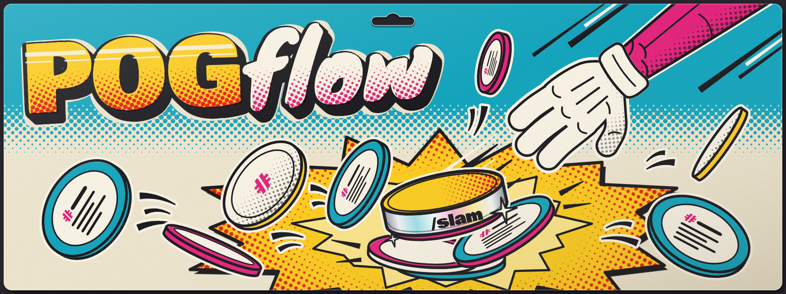

# POGflow

**POG Over Guesswork.** A small convention (shoehorned into 90s nostalgia) for keeping track of open work when several coding-agent sessions run side by side: one file per piece of work, so sessions do not collide in one shared status file.

**Status:** prototype

> Each pog says where its work stands, once. Every list of open work is printed from the pogs, never edited.

That is all it does. It does not plan the work or make any decision for you. Designs stay in [plans](#pogs-and-plans), what a repo needs you to know stays in its notes, and how the work inside a pog gets done is up to the session that holds it.

## Why

When every session edits one status file, sessions overwrite each other and the file drifts from the work. With one file per piece of work, each session writes only its own, and a new session, the other computer, or you in two weeks can read where that work stands.

## A pog

A pog is one piece of work: one file under `pogs/`, named for the work. `pogs/` is a flat folder beside `plans/` in the repo that holds your plans.

```markdown
# Dose-response figure

**State:** open
**Tags:** twop
**Waiting on Stephen:** pick the normalization, baseline or vehicle (2026-11-09)
**Next:** the summary figure, once the normalization is set

## Log
- 2026-11-09 lab 3f9c21ab (dose-response fits): fits converge; stopped for the normalization
- 2026-11-02 lab 77e0b4d2 (dose-response setup): the sessions listed in the plan

## Notes
Plan: `plans/dose-response.md`

**Q (2026-11-09):** normalize to baseline or to vehicle? **A:**
```

Anything else that mentions the work points to the pog and does not restate it.

## The words

- **pog:** one piece of work, one file.
  - **face:** the four lines under the title: State, Tags, Waiting, Next.
  - **log:** dated lines under the face, newest first. Each names the machine and the session that wrote it, by an id that stays the same when the session is renamed, with its name at the time in brackets. A line is added only when something happened.
  - **notes:** the rest of the file. The plan link goes here, and each question with its answer beside it, so rewriting the face loses nothing.
- **stack:** the face of every open pog. With no work named, start here: pull, then print it:

  ```sh
  grep -r -A3 '^\*\*State:\*\* open' pogs/
  ```

  - **pick up:** pull, read the pog you are given, then carry on.
- **slam:** at every stop, update the pog's face, add a log line, commit, push.
- **flip:** when told to, set State to `done` and slam, whether the work was finished or dropped; the log line says which. The pog leaves the stack; the file stays as the record. Before a flip the session asks once whether anything in the notes should outlive the work: nothing, move it now into the repo's notes or plan, or later. Later keeps the pog open with that write-up as its Next, and it flips when the write-up is done.

A stop is when the session waits on you, when you answer, and at the end. Slam each pog the session worked on, so a session that dies loses only its last stretch. An answer for a pog the session does not hold goes in that pog.

State is `open`, `parked` (set aside) or `done`. To park or reopen a pog, change State and slam. Waiting lists what waits on you, each item with the date it was first asked; it is empty when nothing does. Its label carries your name: `Waiting on Stephen:` in the example. Tags group pogs by topic.

## Pogs and plans

A plan says what to build and why; a pog says where the work stands. A plan here is the kind Claude Code writes in plan mode: a Markdown file, written before the work starts. It is kept in the repo, under `plans/`. Pogs are not tied to planning: a pog can be any scope. The cost is a few more files.

- **A plan holds no live status.** When a plan's work gets a pog, add a link to the pog in the plan. If the plan file has a status line, date it then and stop updating it. Until then, leave the line alone.
- **A pog links to the plan it works toward,** if there is one. Several pogs can link to one plan. What is built is in their logs. Notes that grow long move to a plan.
- **One player per pog.** The session that picks a pog up or makes it holds it. A session can hold several pogs, but a pog has one session at a time. Agents that session launches read the pog and do not write it.
- **Split when a part would be picked up on its own,** or a second session needs it. Give that part its own pog, and say so in both logs.
- **New work gets a pog when it starts.** A one-off, such as a typo fix, needs none.

## An example

**Monday, lab Mac.**

> **Stephen:** what's on the stack?
>
> **Session:** Nothing waits on you. Open: dose-response, next is the fits.
>
> **Stephen:** pick up dose-response.

The session reads `pogs/dose-response.md` and runs the fits. They converge, but the next step needs a decision. The session writes the question in the notes and slams. The pog now reads as in [A pog](#a-pog) above. Later that session is closed.

**Wednesday, laptop. A new session that knows nothing.**

> **Stephen:** pick up dose-response. Use vehicle.

It reads the pog, so it knows what was done and what was asked. It writes the answer beside the question and slams: Waiting is empty, and Next is the summary figure.

**Friday.**

> **Stephen:** the figure looks right. Flip it.

The session asks whether anything in the notes should be kept; Stephen says the normalization choice belongs in the repo's notes. The session writes it there and flips. dose-response is off the stack.

## Install

For Claude Code the tools are skills, in `skills/`. On each computer, clone this repo into your skills folder:

```sh
git clone https://github.com/stephenholtz/POGflow ~/.claude/skills/pogflow
```

New sessions then have `/stack`, `/pick-up` and `/slam`, and `git pull` there updates them. Their full names are `/pogflow:stack`, `/pogflow:pick-up` and `/pogflow:slam`, for when another command has the short one. A link to a clone you already have works too.

Slam commits and pushes files under `pogs/` without asking each time. To start in a repo, make the `pogs/` folder yourself; the skills never make it. In a repo without one they do nothing unless you ask for them.

## Licence

Written by Stephen Holtz. MIT ([LICENSE](LICENSE)).
